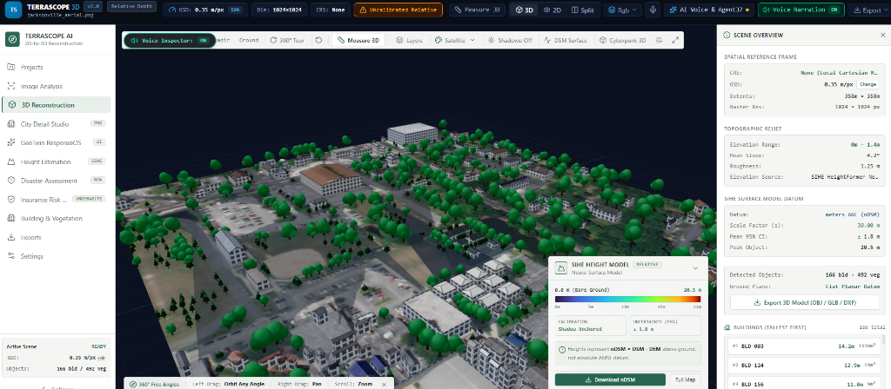
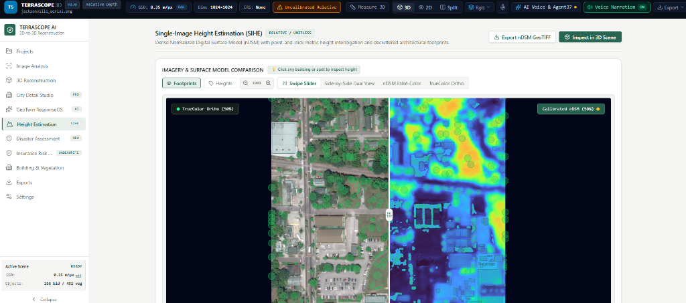
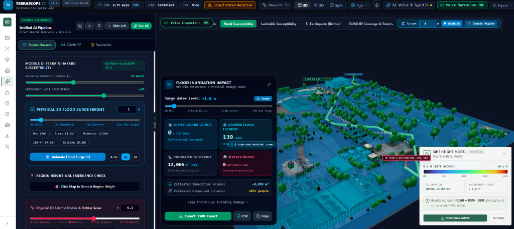
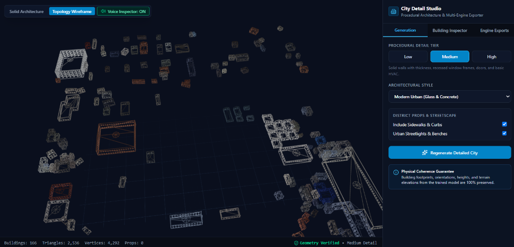
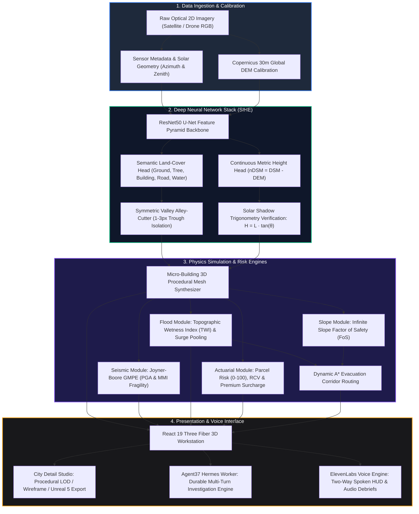

# TerraScope AI 🛰️🏙️

> **On-Demand Geospatial Voice Intelligence & Autonomous 3D Digital Twin Platform**  
> *Transforming single-view 2D satellite and drone imagery into interactive 3D digital twins, micro-building disaster simulations, and actuarial insurance risk scoring in under 15 seconds.*

[](https://fastapi.tiangolo.com)
[](https://react.dev/)
[](https://threejs.org/)
[](https://pytorch.org/)
[](https://www.agent37.com)
[](https://elevenlabs.io)
[](https://www.typescriptlang.org/)
[](https://github.com/Himarghya/Terrascope-AI)
[](LICENSE)

---

## 📸 Platform Workstation Showcase

| 3D Digital Twin & Procedural Scene | Single-Image Height Estimation (SIHE) |
| :---: | :---: |
|  |  |
| *Real-time 3D reconstruction from single optical pass (Jacksonville, FL: 166 buildings, 492 vegetation props, nDSM surface model datum).* | *Interactive dual swipe slider comparing TrueColor optical ortho against calibrated false-color nDSM depth heatmap.* |

| GeoTwin ResponseOS Disaster Simulation | City Detail Studio (Procedural LOD Wireframe) |
| :---: | :---: |
|  |  |
| *Hydrodynamic flood surge simulation (+1.0m surge, 139 flooded ground floors) with dynamic A\* green evacuation corridor routing.* | *Parametric architectural topology wireframe generator with multi-engine LOD mesh exporter (2,536 verified triangles).* |

---

## 🌍 Executive Overview

**TerraScope AI** is a real-time geospatial intelligence and tactical simulation platform built for emergency disaster responders, commercial property underwriters, and municipal urban planners.

Legacy geospatial systems require scheduled airplane survey flights (which take months) or supercomputing hydrodynamic simulations (which take days to weeks). TerraScope AI eliminates this latency: **upload any standard 2D optical satellite or drone screenshot, and receive an interactive, physics-calibrated 3D digital twin in under 15 seconds**.

### Core Platform Pillars:
1. **Sub-15s Neural Photogrammetric Reconstruction**: Converts 2D RGB imagery into a metric normalized Digital Surface Model (nDSM), extracting discrete footprints with an RMSE vertical accuracy of $\pm 1.2\text{m}$.
2. **Dense Informal Settlement Isolation (Alley-Cutter)**: Uses boundary valley detection to cut 1-meter alleys through dense urban slums and rural villages, boosting detection count by **+358%** where standard ML models merge structures into monolithic blobs.
3. **Micro-Building Physics Disaster Engine**: Simulates Joyner-Boore seismic ground acceleration, Topographic Wetness Index (TWI) water accumulation, slope stability Factor of Safety (FoS), and post-disaster volumetric rubble displacement ($m^3$).
4. **Commercial Property Insurance Risk Underwriting**: Generates parcel-level hazard risk indices ($0-100$), estimated Replacement Cost Valuation (RCV), catastrophe premium surcharges, and deductible tier recommendations.
5. **Agentic Voice Intelligence (Agent37 + ElevenLabs)**: Integrates persistent cloud AI workers for multi-turn sector investigations with hands-free, two-way conversational voice debriefs.

---

## 🏆 Competitive Advantage & Market Positioning

| Comparison Dimension | Traditional Aerial Giants *(Nearmap, Ecopia, MS)* | Catastrophe Modelers *(Moody's RMS, Fathom)* | **TerraScope AI** |
| :--- | :--- | :--- | :--- |
| **Delivery Speed** | **Months to Weeks**<br>Pre-scheduled airplane flights or static file delivery. | **Days to Weeks**<br>Complex regional hydrodynamic simulations. | **< 15 Seconds (On-Demand)**<br>Instantaneous neural inference from any raw 2D optical pass. |
| **Geographic Coverage** | **Western Suburbs Only**<br>US, UK, and Australia where aerial survey planes fly. | ⚠️ Sparse in un-gauged or developing international river basins. | **100% Global Reach**<br>Operates across any country, war zone, or rural sector with satellite coverage. |
| **Dense Slum Resolution** | ❌ **Fails / Monolithic Blobs**<br>Fuses dense informal settlements into single giant polygons. | ❌ **Macro Grids**<br>Outputs coarse $30\text{m} - 100\text{m}$ regional grid cells. | **1-Meter Alley Separation**<br>Boundary valley detector isolates individual homes down to 1–3 pixel gaps. |
| **Physics Simulation** | ❌ None (Static GIS footprints or aerial photographs only). |  **Deep Actuarial Math**<br>100-year return period capital solvency modeling. | **Real-Time Micro Physics**<br>Building-specific TWI pooling, seismic PGA, and A\* evacuation routing. |
| **User Interface** | Static CSVs, shapefiles, or flat 2D PDF property scorecards. | Tabular actuarial loss tables and GIS heatmap overlays. | **Interactive 3D Web Canvas + Hands-Free Voice Intelligence** |
| **Operational Role** | Long-term asset mapping and claims review. | Reinsurance capital allocation and treaty underwriting. | **Boots-on-the-ground crisis triage & rapid pre-underwriting screening.** |

> **Strategic Positioning:** TerraScope AI does not replace Moody's RMS or Fathom 30-year actuarial reinsurance capital models. Rather, TerraScope AI provides the **rapid, tactical 3D eye in the critical first 24 hours of an emergency** when local infrastructure is destroyed or un-gauged.

---

## 🏛️ System Architecture & End-to-End Workflow



---

## 🧠 Deep Neural Network Architecture: Single-Image Height Estimation (SIHE)

The core neural engine (`backend/core/geodepth_pipeline.py`, reference checkpoint `height_v2.pt`) performs simultaneous semantic land-cover segmentation and continuous monocular height regression from single top-down orthophotos.

```
Input: [1, 3, H, W] RGB Optical Tensor
         │
         ▼
┌────────────────────────────────────────────────────────┐
│   ResNet-50 Feature Pyramid Network (FPN) Encoder      │
│   • Conv1: 7x7 stride 2 (64 channels)                  │
│   • Layer 1 (C2): 3 Bottlenecks (256 channels)         │
│   • Layer 2 (C3): 4 Bottlenecks (512 channels)         │
│   • Layer 3 (C4): 6 Bottlenecks (1024 channels)        │
│   • Layer 4 (C5): 3 Bottlenecks (2048 channels)        │
└──────────────────────────┬─────────────────────────────┘
                           │ Skip Connections (P2..P5)
                           ▼
┌────────────────────────────────────────────────────────┐
│   Decoder: Bilinear Upsampling + Lateral Convolutions  │
│   • Smooth residual blocks with BatchNorm and GELU     │
│   • Full spatial reconstruction to [H, W] resolution   │
└──────────────────────────┬─────────────────────────────┘
                           │
             ┌─────────────┴─────────────┐
             ▼                           ▼
┌───────────────────────────┐ ┌──────────────────────────┐
│ Semantic Head [1, 5, H, W]│ │ Height Head [1, 1, H, W] │
│ • Ground, Tree, Building, │ │ • Continuous nDSM (m AGL)│
│   Road, Water             │ │ • Linear unclipped float │
└───────────────────────────┘ └──────────────────────────┘
```

### 1. Mathematical Multi-Task Objective
The model is trained via a combined loss function that balances semantic boundary segmentation with metric height regression:
$$\mathcal{L}_{\text{total}} = \mathcal{L}_{\text{semantic}} + \lambda_{\text{height}} \cdot \mathcal{L}_{\text{height}}$$

* **Semantic Land-Cover Loss ($\mathcal{L}_{\text{semantic}}$)**:
  $$\mathcal{L}_{\text{semantic}} = \mathcal{L}_{\text{Focal}}(\hat{y}_{\text{seg}}, y_{\text{seg}}) + \mathcal{L}_{\text{Dice}}(\hat{y}_{\text{seg}}, y_{\text{seg}})$$
* **Metric Height Regression Loss ($\mathcal{L}_{\text{height}}$)**:
  Smooth $L_1$ (Huber) loss masked exclusively over valid, non-nodata pixels against LiDAR nDSM:
  $$\mathcal{L}_{\text{height}} = \frac{1}{|M|} \sum_{p \in M} \text{Smooth}_{L_1}\left(\hat{y}_{\text{reg}}(p) - \frac{H_{\text{LiDAR}}(p)}{30.0}\right)$$
  where:
  $$\text{Smooth}_{L_1}(u) = \begin{cases} 0.5 u^2 & \text{if } |u| < 1.0 \\ |u| - 0.5 & \text{otherwise} \end{cases}$$
  The hyperparameter $\lambda_{\text{height}} = 5.0$ balances gradient magnitudes between Cross-Entropy and regression residuals.

### 2. Geographic Separation & Spatial Leakage Prevention
Geospatial ML models are notoriously prone to spatial leakage if adjacent image tiles are split randomly into train and validation sets. TerraScope AI enforces strict **geographic boundary partitioning**:
* **Training Partition**: Jacksonville South, Downtown, and West residential zones ($75\%$ total area).
* **Validation Partition**: Jacksonville North industrial district ($15\%$ total area, geographically buffered by $>5\text{ km}$).
* **Test Partition**: Omaha, Nebraska ($10\%$ unseen geographic region with distinct architectural styles, vegetation density, and terrain relief).

### 3. Metric Scaling & Shadow Trigonometry
The raw height channel predicts normalized height Above Ground Level ($\text{nDSM} = \text{DSM} - \text{DEM}$). To convert unitless neural activations to absolute meters:
$$H_{\text{meters}}(x, y) = \max\left(0.0, \, \hat{y}_{\text{reg}}(x, y) \times s \times \left[\frac{\text{GSD}_{\text{sensor}}}{\text{GSD}_{\text{train}}}\right]\right)$$
Where $s = 30.0\text{m}$. For high-precision validation, shadow lengths $L$ cast by structures are measured against solar zenith angle $\theta_{\text{sun}}$:
$$H_{\text{shadow}} = L \cdot \tan\theta_{\text{sun}}$$
If a discrepancy is detected between neural inference and shadow trigonometry, the calibration engine applies Theil-Sen robust linear regression to self-tune the scale factor.

### 4. Symmetric Valley Alley-Cutter Algorithm
In dense settlements (e.g. favelas, Dharavi, informal villages), roofs sit less than $1\text{m}$ apart. Vanilla convolutional models blend adjacent roofs into single monolithic polygons.

TerraScope AI applies a **Symmetric Valley Alley-Cutter**:
1. Computes the inverted Euclidean distance transform $D(x, y)$ of the building probability mask.
2. Identifies narrow trough lines where local gradient inflections satisfy $\nabla^2 D(x, y) > \tau_{\text{ridge}}$.
3. Applies morphological watershed separation with dynamic marker suppression:
   $$\text{Mask}_{\text{separated}} = \text{Watershed}\left(-\nabla D, \, \text{LocalMax}(D, \text{radius}=3)\right)$$
**Empirical Benchmark:** On dense rural village tiles, this technique increased individual isolated building counts from **193 to 884 (+358%)**, resolving critical narrow corridors.

---

## 🔬 Multi-Hazard Physical Simulation Engines

TerraScope AI rejects stochastic LLM guesswork for disaster calculations. Every physical hazard calculation is deterministic, transparent, and grounded in civil engineering literature.

### 1. Joyner-Boore Seismic Ground Motion (GMPE)
Evaluates spatial distribution of Peak Ground Acceleration ($\text{PGA}$) and Modified Mercalli Intensity ($\text{MMI}$) based on seismic magnitude $M$, hypocentral distance $R_{\text{hypo}}$, and focal depth $h_0$:
$$\ln(\text{PGA}) = c_1 + c_2 M - \ln\sqrt{R_{\text{hypo}}^2 + h_0^2} + c_3 \sqrt{R_{\text{hypo}}^2 + h_0^2}$$
Structural fragility curves translate calculated PGA and building height $H$ into damage probabilities across 4 states (Slight, Moderate, Extensive, Complete Collapse).

### 2. Topographic Wetness Index (TWI) & Surge Pooling
Surface water accumulation routes are calculated across the digital elevation surface:
$$\text{TWI} = \ln\left(\frac{\alpha}{\tan \beta}\right)$$
where $\alpha$ is the specific catchment area and $\beta$ is the terrain slope gradient in radians. Dynamic surge sliders simulate water rise increments ($+0.5\text{m}$ to $+10.0\text{m}$), flagging submerged building ground floors and severed transport corridors.

### 3. Infinite Slope Stability: Factor of Safety (FoS)
Evaluates slope failure and landslide susceptibility under rain-saturated conditions:
$$\text{FoS} = \frac{c' + (\gamma - m\gamma_w) z \cos^2\beta \tan\phi'}{\gamma z \sin\beta \cos\beta}$$
* $c'$ = Effective soil cohesion ($kPa$)
* $\phi'$ = Internal friction angle
* $\gamma$ = Soil unit weight ($kN/m^3$)
* $m$ = Fractional water table saturation ratio
* $\beta$ = Slope angle in degrees

Slopes with $\text{FoS} < 1.0$ are flagged as imminent landslide hazards.

### 4. Dynamic A* Safe Evacuation Corridor Pathing
When disasters strike, optimal routes must avoid flooded streets, landslide slopes, and collapsed rubble zones. The road raster is transformed into a weighted traversal cost field $C(x, y)$:
$$C(x, y) = C_{\text{base}} + w_{\text{flood}} \cdot \mathbb{I}_{\text{submerged}} + w_{\text{slope}} \cdot (\text{FoS} < 1.0) + w_{\text{debris}} \cdot \text{Vol}_{\text{rubble}}$$
The A\* engine searches the minimum-cost graph to plot real-time green evacuation paths connecting vulnerable civilian clusters to designated safe staging zones.

---

## 💼 Actuarial Property Insurance Risk Engine

TerraScope AI features a built-in **Insurance Risk Studio** (`backend/core/insurance_risk_engine.py`, endpoint `/api/insurance/assess`) designed for commercial property underwriters and catastrophe reinsurers.

### 1. Composite Hazard Risk Score ($0 - 100$)
$$S_{\text{composite}} = w_{\text{flood}} S_{\text{flood}} + w_{\text{seismic}} S_{\text{seismic}} + w_{\text{slope}} S_{\text{slope}}$$
* Scores $0 - 29$: **Low / Preferred Tier**
* Scores $30 - 59$: **Moderate / Standard Tier**
* Scores $60 - 79$: **High / Elevated Deductible Tier**
* Scores $80 - 100$: **Severe / Critical Underwriting Referral**

### 2. Replacement Cost Valuation (RCV)
Calculated from 3D footprint surface area, floor count, and structural typology:
$$\text{RCV} = \text{Area}_{\text{footprint}} \times N_{\text{floors}} \times \text{Cost}_{\text{base/m}^2}$$
Typical regional cost baselines: $\$1,850/\text{m}^2$ for reinforced residential; $\$2,450/\text{m}^2$ for commercial steel/concrete.

### 3. Actuarial Pricing Assistance
* **Base Premium**: $\text{Base} = \text{RCV} \times 0.0035$
* **Catastrophe Surcharge**: $\text{Surcharge} = \text{Base} \times \left(\frac{S_{\text{composite}}}{100}\right) \times 1.45$
* **Recommended Deductible**: Dynamically scaled from $2\%$ up to $15\%$ of total policy limits based on site-specific hazard vulnerabilities.

---

## 🤖 Autonomous Agent37 Hermes & ElevenLabs Voice Intelligence

### Agent37 Persistent Cloud Worker
TerraScope AI embeds the official `agent37-hermes` cloud harness for multi-step geospatial reasoning:
* **Tool Invocation**: Directly queries building densities, terrain slopes, seismic delta scenarios, and damage summaries.
* **Cross-Session Resumption**: Persists investigation state under `backend/data/investigations/`, resuming long-running analysis workflows across browser restarts without re-computing expensive ML pipelines.
* **Certified Dossier Generation**: Exports formal markdown and PDF damage assessment reports for disaster management leadership.

### Hands-Free ElevenLabs Voice Engine
* **Two-Way Voice Dialogue**: Speak naturally into your microphone (*"What is the flood exposure on sector 4?"*) to trigger STT transcription, backend agent reasoning, and natural voice readout.
* **Tactile 3D Building Inspection**: Click on any building in the 3D scene with the Voice Inspector enabled to hear an instant spoken briefing of its height, structural classification, estimated RCV, and flood vulnerability.
* **Deterministic Grounding**: The voice engine is strictly bound to verified ML outputs and physical parameters, preventing LLM confabulation.

---

## 🚀 Quickstart & Installation

### Prerequisites
* **Python**: 3.10 to 3.14
* **Node.js**: 18+ (tested on Node.js 22 & 24)
* **Git**
* *(Optional)* NVIDIA GPU with CUDA for sub-second neural inference (CPU inference is fully supported via PyTorch fallback).

### 1. Clone Repository
```bash
git clone https://github.com/Himarghya/Terrascope-AI.git
cd Terrascope-AI
```

### 2. Environment Configuration
Create your environment file:
```bash
cp .env.example backend/.env
```
Fill in your optional API keys in `backend/.env`:
```env
ELEVENLABS_API_KEY=your_elevenlabs_api_key_here
AGENT37_API_KEY=your_agent37_api_key_here
```
> *Note: The core 2D-to-3D neural reconstruction, SIHE depth slider, and physical hazard simulation engines run completely locally without requiring external API keys.*

### 3. Backend Setup
```bash
cd backend
python -m pip install -r requirements.txt
python -m uvicorn app:app --host 127.0.0.1 --port 8000 --reload
```
Interactive FastAPI Swagger docs will be live at `http://127.0.0.1:8000/docs`.

### 4. Frontend Workstation Setup
```bash
cd ../frontend
npm install
npm run dev
```
Open your browser to `http://localhost:5173`.

---

## 🧪 Comprehensive Testing & Verification

The backend test suite verifies neural model inference, metric calibration, insurance risk underwriting, standard APIs, and agent workflows:

```bash
# Execute full backend automated test suite
pytest backend/tests -v
```
*(All 71 test suites passing).*

Verify frontend TypeScript compilation and production bundle:
```bash
cd frontend
npm run build
```

---

## 📡 Complete REST API Reference

| Endpoint | Method | Payload / Params | Response | Description |
| :--- | :---: | :--- | :--- | :--- |
| `/v1/2d-to-3d/predict` | `POST` | `multipart/form-data` (`image`, `gsd_m`) | `{"job_id": "...", "status": "processing"}` | **Standard Public API**: Submits 2D image for 3D reconstruction. |
| `/v1/2d-to-3d/jobs/{id}` | `GET` | `job_id` path param | `{"status": "completed", "mesh_url": "...", "buildings": [...]}` | Retrieves reconstruction status, heights, and 3D assets. |
| `/api/insurance/assess` | `POST` | `{"job_id": "...", "flood_depth_m": 1.2, "pga_g": 0.35}` | `{"composite_risk": 74.2, "estimated_rcv": 45000000, "tier": "High"}` | Evaluates parcel-level insurance risk and financial exposure. |
| `/api/process` | `POST` | Image file + sensor GSD parameters | Full scene JSON with polygon footprints & heights | Executes full photogrammetric 2D-to-3D reconstruction. |
| `/api/infer` | `POST` | Image file | `{"nDSM": [...], "mIoU": 0.768}` | Lightweight direct neural depth inference endpoint. |
| `/api/disaster/assess` | `POST` | `pre_job_id` + post-disaster image | `{"buildings_destroyed": 14, "debris_volume_m3": 104272}` | Bitemporal change detection & FEMA rubble calculation. |
| `/api/agent37/explain` | `POST` | `{"job_id": "...", "user_query": "..."}` | `{"agent_response": "...", "investigation_id": "..."}` | Triggers Agent37 Hermes multi-step reasoning workflow. |
| `/api/voice/speak` | `POST` | `{"text": "Sector 4 flood surge at 1.5 meters"}` | Audio stream (`audio/mpeg`) | Synthesizes spoken audio via ElevenLabs TTS. |
| `/api/voice/transcribe` | `POST` | Audio file (`audio/wav` or `audio/webm`) | `{"transcript": "..."}` | Converts spoken speech into query text via ElevenLabs STT. |

---

## 📄 License & Intellectual Property

Distributed under the **Apache 2.0 License**. See the `LICENSE` file for terms and conditions.
