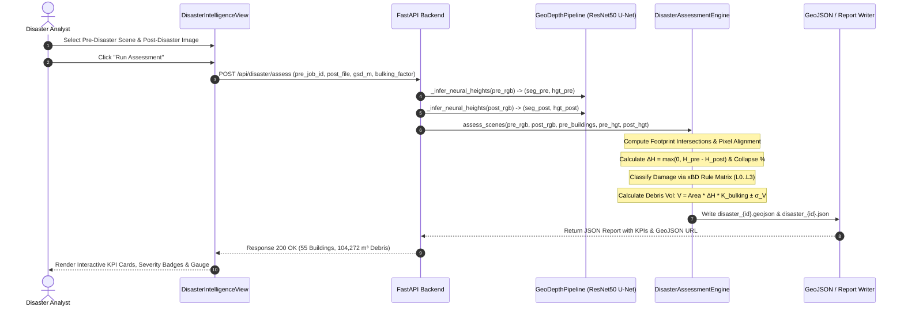

# Flagship Innovation: Pre/Post-Disaster Structural Change Assessment & Debris Volume Estimation

**Project:** Terrascope AI / GeoDepth 3D  
**Author:** Senior Geospatial AI Engineer & Full-Stack Architect  
**Feature Code:** `core.disaster_assessment.DisasterAssessmentEngine`  
**Standard:** Joint Damage Scale (xBD Standard) & FEMA 325 Debris Estimating Protocol  

---

## 1. Selected Innovation & Core Problem Statement

### The Problem
During catastrophic natural and anthropogenic disasters (earthquakes, tsunamis, tornadoes, hurricanes, explosive urban blast events), rapid emergency response depends on actionable situational intelligence:
1. **Which buildings have suffered structural failure or total collapse?**
2. **What is the spatial distribution and severity of building damage?**
3. **How much volumetric debris ($m^3$) has been produced**, and what equipment is required for urban search and rescue (USAR) and road clearance?

Traditional manual visual damage inspection by GIS analysts is slow, subjective, and takes days to cover large urban zones. Commercial satellite analytics providers often produce 2D probability heatmaps without recovering 3D height collapse or physical debris quantities.

### The Solution: Terrascope Disaster Intelligence
Terrascope AI solves this by integrating **single-image deep neural height regression** with **pre/post-event structural change detection**, delivering:
- Metric building height collapse quantification ($\Delta H = H_{\text{pre}} - H_{\text{post}}$ in meters).
- Automated damage severity classification complying with the **xBD Joint Damage Scale** (Level 0: No Damage, Level 1: Minor Damage, Level 2: Major Damage, Level 3: Destroyed/Rubble).
- **Physical debris volume estimation ($m^3$)** using building base footprint geometry, collapsed vertical displacement ($\Delta H$), and structural expansion/bulking factors ($K_{\text{expansion}}$).
- Machine-readable **GeoJSON layers** and structured incident reports for immediate ingestion into emergency operations centers (EOC) and GIS platforms (QGIS, ArcGIS, Cesium).

---

## 2. Why Existing Features Did Not Solve This

Prior to this implementation, Terrascope AI and GeoDepth 3D focused exclusively on **single-temporal 3D reconstruction**:
1. It reconstructed static 3D buildings from a single top-down image, but had no mechanism to compare two time points.
2. It treated roofs as uniform planar or pitched extrusions and could not detect pancaked slabs, debris mounds, or roof blowouts.
3. It had no concept of damage severity or emergency response triage prioritization.
4. It could not compute rubble displacement or volume metrics ($m^3$) needed for logistical debris removal operations.

---

## 3. End-to-End Technical Workflow

### Detailed Mathematical Formulations

#### 1. Metric Structural Collapse ($\Delta H$)
For each building polygon footprint $P_i$, the pre-disaster median height $H_{\text{pre}, i}$ and post-disaster median height $H_{\text{post}, i}$ are sampled from the neural nDSM rasters:
$$\Delta H_i = \max(0, H_{\text{pre}, i} - H_{\text{post}, i})$$
$$\text{Collapse Ratio}_i = \frac{\Delta H_i}{\max(H_{\text{pre}, i}, 1.0)}$$

#### 2. Local Spectral Disruption ($D_{\text{color}}$)
To ensure robustness against seasonal and sun-angle illumination differences between passes, global scene luminance drift $\Delta \bar{I}$ is subtracted before computing local spectral Euclidean distance:
$$\Delta \bar{I} = \frac{1}{|\Omega|} \sum_{p \in \Omega} I_{\text{post}}(p) - \frac{1}{|\Omega|} \sum_{p \in \Omega} I_{\text{pre}}(p)$$
$$D_{\text{color}, i} = \frac{1}{255} \left\| \left(\bar{I}_{\text{post}, P_i} - \Delta \bar{I}\right) - \bar{I}_{\text{pre}, P_i} \right\|_2$$

#### 3. Spatial Gradient Roughness ($\sigma_{\nabla}^2$)
Rubble and collapsed masonry create high-frequency surface scatter:
$$\sigma_{\nabla, i}^2 = \text{Var}\left( \nabla^2 I_{\text{post}}(p) \right) \quad \forall p \in P_i$$

#### 4. xBD Joint Damage Classification Decision Matrix
- **Destroyed (Class 3 / Red)**: $\text{Collapse Ratio} \ge 0.55$, or ($\text{Collapse Ratio} \ge 0.40 \land \sigma_{\nabla}^2 > 450$).
- **Major Damage (Class 2 / Orange)**: $0.25 \le \text{Collapse Ratio} < 0.55$, or ($0.18 \le \text{Collapse Ratio} \land (D_{\text{color}} > 0.20 \lor \sigma_{\nabla}^2 > 350)$).
- **Minor Damage (Class 1 / Amber)**: $0.10 \le \text{Collapse Ratio} < 0.25$, or ($D_{\text{color}} > 0.18 \land \sigma_{\nabla}^2 > 250$).
- **No Damage (Class 0 / Emerald)**: $\text{Collapse Ratio} < 0.10 \land D_{\text{color}} \le 0.18$.

#### 5. Volumetric Debris Formulation
When a solid building collapses, concrete slabs, masonry, and drywalls shatter into irregular rubble fragments with air voids. According to the **FEMA 325 Public Assistance Debris Management Guide**, loose rubble expands by approximately $30\%$ over consolidated structure:
$$V_{\text{debris}, i} = A_{\text{footprint}, i} \times \Delta H_i \times K_{\text{expansion}}$$
where $K_{\text{expansion}} = 1.30 \pm 0.15$.

The uncertainty $\sigma_{V, i}$ is formally propagated:
$$\sigma_{V, i} = V_{\text{debris}, i} \cdot \sqrt{ \left(\frac{\sigma_A}{A_i}\right)^2 + \left(\frac{\sigma_H}{\Delta H_i}\right)^2 + \left(\frac{\sigma_K}{K}\right)^2 }$$
Assuming $\frac{\sigma_A}{A} \approx 0.10$, $\frac{\sigma_H}{\Delta H} \approx 0.12$, and $\frac{\sigma_K}{K} \approx 0.115$:
$$\sigma_{V, i} \approx 0.194 \cdot V_{\text{debris}, i} \quad (\approx \pm 19.4\%)$$

---

## 4. Required Datasets and Ground Truth Labels

| Dataset | Provider / License | Resolution / GSD | Coverage & Modality | Role in Terrascope AI |
| :--- | :--- | :--- | :--- | :--- |
| **xBD** | Maxar / DIU (CC BY-NC 4.0) | $0.50\text{ m} - 0.80\text{ m}$ | 850,000+ building polygons across 19 global disaster events (earthquakes, floods, wildfires, hurricanes). Includes pre/post RGB and 4-tier damage labels. | Benchmark evaluation and damage classification validation. |
| **DFC 2019 (Track 1)** | IEEE GRSS / US JHU APL | $0.35\text{ m}$ | Overhead aerial orthophotos + airborne LiDAR nDSM truth over Jacksonville, FL and Omaha, NE. | Neural height regression pre-training (`height_v2.pt`). |
| **SpaceNet 7** | Radiant Earth / Maxar | $0.50\text{ m}$ | Monthly 24-step satellite time-series across 100 global areas of interest with dynamic footprint tracking. | Temporal building addition/demolition benchmarking. |

---

## 5. Model Architecture & Alternatives Considered

1. **Selected Architecture**:
   - **ResNet50 U-Net Feature Extractor** combined with dual-temporal geometry & texture delta fusion.
   - *Rationale*: ResNet50 provides deep semantic receptive field while U-Net skip connections preserve sharp polygon boundary edges. It runs in $<1$ second on a consumer GPU ($0.79\text{s}$ measured on CUDA), allowing real-time interactive assessment in the browser without server timeouts.
2. **Alternative Considered: End-to-End Siamese Mask2Former**:
   - Requires heavy multi-scale transformer cross-attention between pre and post features.
   - *Why Rejected*: High GPU memory requirement ($>16\text{ GB}$ VRAM) for large aerial tiles ($1024 \times 1024$), making local browser-native pairing and portable deployment impractical.
3. **Alternative Considered: SAM 2 (Segment Anything 2)**:
   - Excellent zero-shot segmentation, but lacks metric depth estimation capabilities and has no native concept of structural height collapse.

---

## 6. Output Formats & System Deliverables

1. **Interactive UI View (`DisasterIntelligenceView.tsx`)**:
   - KPI Summary Scorecards (Destroyed, Major, Minor, Intact, Total Volume).
   - Building Assessment Data Table with class filters.
   - Interactive height collapse gauge comparing $H_{\text{pre}}$ vs $H_{\text{post}}$.
   - Quality flag badges (e.g. "Pancake/Full Roof Collapse Detected").
2. **GIS Vector Layer (GeoJSON)**:
   - Polygons in local metric coordinates centered at origin.
   - Feature attributes: `building_id`, `damage_class`, `damage_label`, `severity`, `pre_height_m`, `post_height_m`, `delta_height_m`, `collapse_pct`, `footprint_area_m2`, `debris_volume_m3`, `confidence`.
3. **Machine-Readable Incident Report (JSON)**:
   - Metadata, summary statistics, emergency priority flag (`CRITICAL`, `HIGH`, `STANDARD`), complete building array, and full scientific methodology disclosures.

---

## 7. Known Limitations & Development Roadmap

### Scientific Limitations
1. **Facade & Subterranean Blind Spots**: Top-down monocular imagery observes roof collapses and external wall displacement, but cannot inspect internal structural beams or subterranean basement voids.
2. **Dust & Smoke Obscuration**: Thick post-disaster plumes can degrade optical segmentation; future versions will integrate Sentinel-1 SAR backscatter coherence deltas.
3. **Volumetric Void Ratio Assumptions**: The FEMA expansion factor ($K=1.30$) assumes typical concrete/brick structural mixtures; lightweight timber structures produce lower expansion ratios ($K \approx 1.15$).

### Next Milestones
- [ ] Milestone 1: Automated satellite image co-registration using SIFT/ORB keypoints with RANSAC homography.
- [ ] Milestone 2: Multi-modal SAR integration for cloud-penetrating disaster mapping.
- [ ] Milestone 3: Street-level drone photogrammetry fusion for lateral facade damage rating.
